# MonzaCubed

This project is a version of Monza (F1 Track based in Italy) replicated with a bunch of tiny cubes to make it MonzaCubed!


## Project 2 (Cube World) 

Team Members: Aditya Pawar, Cameron Pocisk

- **Live app:** https://monzacubed.vercel.app/
- **Demo video:** <!-- video link -->
- **Source code:** https://github.com/CameronPocisk/MonzaCubed


If you want to run it on your own computer, opening ```index.html``` directly won't work (the browser blocks loading the images and JS modules from a file). You need a local server like Live Server. In order to do so, please right-click the index.html file in VS Code and click 'Open with Live Server' and then you can access it!


## 1. Design


The reason we chose Monza was because when we read the project guidelines where we had to create a world from an image and a height map- we thought that a F1 Track would be the most fun one to recreate as then we can have Bezier Curves depicting the track as well and have objects follow the track so they can be cars racing!

Also another reason we chose Monza was because it is the simplest F1 Track to recreate. There's only a few sections of elevations and it contains mostly straights and a couple of turns which is a stark contrast to the other tracks which have a lot of twists & turns which would be difficult to replicate with a Bezier Curve.

Before writing any code, we did research on the Imagery available to us and how we can port over a height map.


## 2. Features and controls

Once you open the Vercel Link or ```index.html``` when hosted locally, you'll be greeted with Level 0 which contains a Cube spinning around with each face having its own color.

On the top bar you can see the title of the Project along with our names on there. We also have a short description of how the levels progress and then we have 6 buttons to access the different levels.

**Quick Jumps:** [Level 0](#level-0) | [Level 1](#level-1) | [Level 2](#level-2) | [Level 3](#level-3) | [Level 4](#level-4) | [Level 4 Fun](#level-4-fun-bonus)


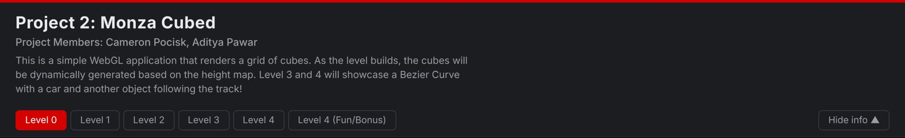

The **Hide info** button on the right collapses the title bar so the canvas gets the whole screen. The canvas resizes on its own to prevent a weird-resolution mismatch. 

### Level 0
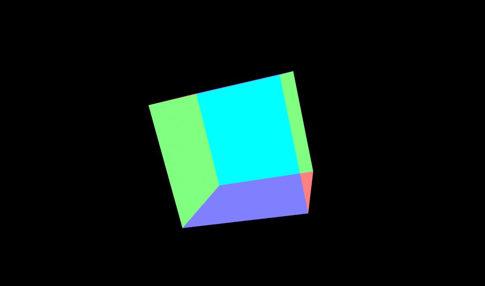

<!-- To-Do: Cameron, talk about how the colors work -->

### Level 1
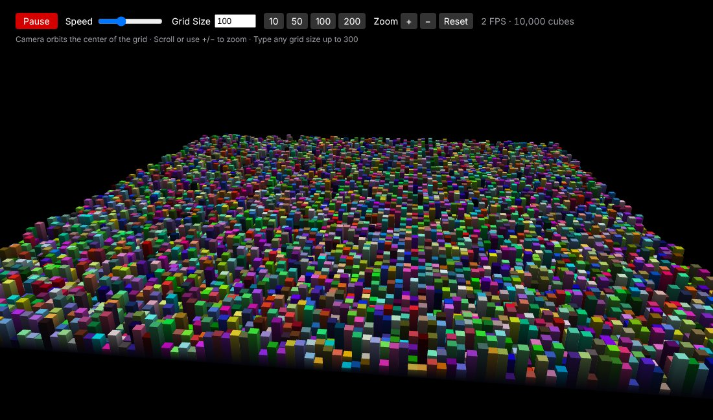

<!-- To-Do: Cameron, talk about how you generated the cubes-->

Level 1 is a grid of cubes, each one with a random height and a random color. The camera rotates around the center of the grid. 

| Control | What it does |
|---|---|
| Grid size box, **10 / 50 / 100 / 200** | Can view different sizes of Grids |
| Speed slider, **Pause / Play** | How fast the camera rotates |
| **+ / − / Reset** |  Zoom in and out |

**Shading:** Every cube only gets one color (`uColor`)- but in the vertex shader we blend it from a dark navy at the bottom of the cube (y = 0) up to that color at the top (y = 1). Since `vColor` is a varying, the GPU interpolates it across each triangle so every pixel ends up with an in-between color, which is where the gradient comes from!

```glsl
vec3 bottomColor = vec3(0.05, 0.05, 0.15);          // dark navy
vColor = mix(bottomColor, uColor, aPosition.y);     // y=0 → bottom, y=1 → uColor
```

Then in the fragment shader we added some simple lighting so you can actually tell the faces of a cube apart:

```glsl
float brightness = max(dot(vNormal, lightDirection), 0.0);
float light = 0.3 + 0.7 * brightness;     // keep 30% so faces in shadow aren't pure black
gl_FragColor = vec4(vColor * light, 1.0);
```

**The Grid:** `buildGrid(size)` makes a size X size grid of cubes centered on the origin. When we draw a cube we stretch it to its height first and then move it to its spot. The order matters here- in `multiply(a, b)` the right side happens first, so scaling goes on the right:

```js
const model = multiply(
  translation(cube.x, 0, cube.z),
  scaling(1, cube.height, 1),
);
```

**Rotating camera:** The camera moves in a circle around the middle of the grid and it's always looking at the center (0, 0, 0). Every frame we bump `angle` up a little bit, and then `cos` and `sin` of that angle give us the x and z of a point on that circle (same as the unit circle from trig, just scaled up by `radius`). That point becomes the eye in `lookAt`, and the center is the target.

The radius and height grow with the grid size so even a 200 X 200 grid fits on the screen. The speed slider changes how much `angle` goes up each frame and Pause just stops it. We multiply by `dt` (the time since the last frame) so it spins at the same speed whether your screen runs at 60 or 120 FPS.

```js
if (playing) angle += dt * 0.2 * Number(speedSlider.value);
const radius = (gridSize * 0.9 + 5) * zoom;
const height = (gridSize * 0.3 + 5) * zoom;
const eye = [radius * Math.cos(angle), height, radius * Math.sin(angle)];
gl.uniformMatrix4fv(uView, false, lookAt(eye, [0, 0, 0], [0, 1, 0]));
```

**Zoom:** All zoom does is multiply the radius of the circle the camera rotates on. The buttons step it (× 0.8 / × 1.25) and scrolling does it smoothly with `Math.exp` so zooming in and out feels the same:

```js
setZoom(zoom * Math.exp(event.deltaY * 0.001));
```

### Level 2
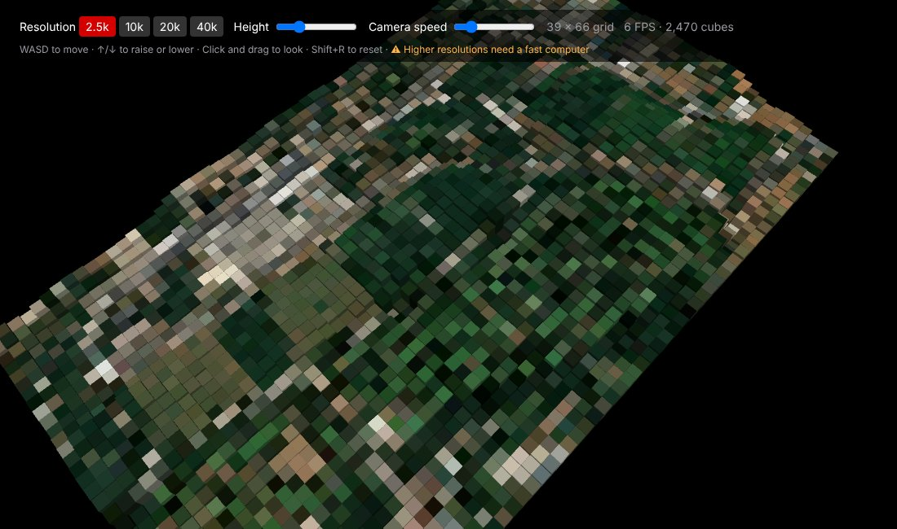

Level 2 builds the landscape from two images of Monza: a satellite photo for the colors and a greyscale heightmap for the heights.  

| Control | What it does |
|---|---|
| **2.5k / 10k / 20k / 40k** | The amount of cubes we can make an image representation out of|
| Height slider | Determines the height map intensity of the Scenery |
| Camera speed slider | How far each WASD press moves |
| **W A S D**, **↑ / ↓**, drag | Move, go up/down, look around |
| **Shift + R** | Reset the camera |


<!-- To-Do: Cameron, talk about how you loaded in the image and the camera!  -->


**Resolution:** It starts off at 2,500 cubes so it loads fast on any laptop, and the buttons let you go all the way up to 40,000. `buildLandscape` builds the new list of cubes first and then swaps it in at the end, so `draw()` never ends up drawing a half-built landscape:

```js
buildLandscape(2500);
```

**Height slider:** The heights stay between 0 and 1 and just get multiplied by the slider every frame- so moving the slider doesn't need a rebuild:

```js
scaling(1, cube.height * Number(heightSlider.value), 1)
```


### Level 3
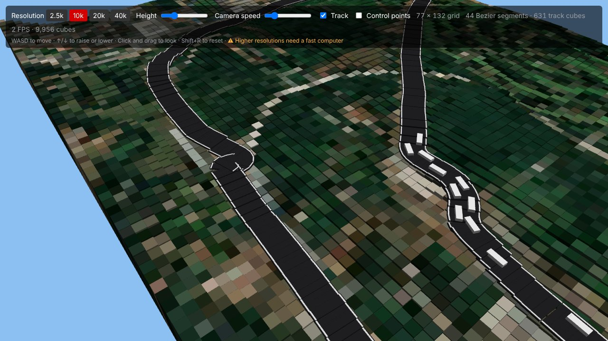
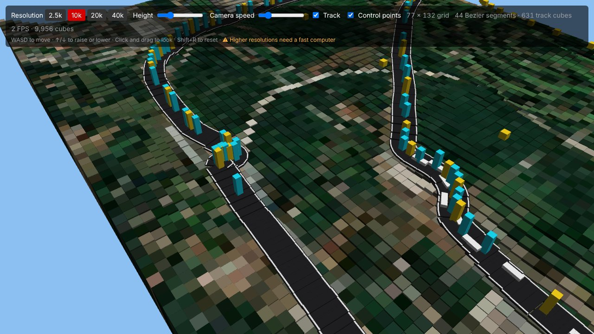
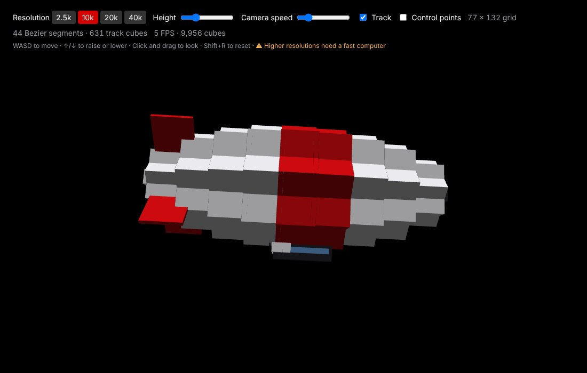

Level 3 puts the Monza track on top of the Level 2 landscape as a Bezier Curve- with 20 cars racing on it, a blimp flying across the sky and two TV helicopters circling the circuit. Everything in the sky is made only out of cubes!

| Control | What it does |
|---|---|
| **Track** checkbox | Show the asphalt road |
| **Control points** checkbox | Show the Bézier control points, the blimp's path and the helicopters' paths |
| Resolution, height, WASD | Same as Level 2 |

Everything that moves in this level uses two functions. `bezier3` takes 4 control points and a `t` between 0 and 1 and gives back where you are on the curve: t = 0 is the start (P0), t = 1 is the end (P3), and anything in between is somewhere along the way. It's a weighted average of the 4 points. The weights `a, b, c, d` always add up to 1, and as t goes up the weight slides over from P0 to P3.

`bezierTangent3` is the derivative of that, so instead of telling us where we are, it tells us which way the curve is going. We use it to point the cars, blimp and helicopters forward. (The full math is in Section 4.)

```js
function bezier3(p0, p1, p2, p3, t) {
  const u = 1 - t;
  const a = u * u * u, b = 3 * u * u * t, c = 3 * u * t * t, d = t * t * t;
  return [ a*p0[0] + b*p1[0] + c*p2[0] + d*p3[0],
           a*p0[1] + b*p1[1] + c*p2[1] + d*p3[1],
           a*p0[2] + b*p1[2] + c*p2[2] + d*p3[2] ];
}
```

*Heads up: the `drawPart` helper below and the models for the blimp and helicopters were generated by AI (Claude). The Bezier paths they fly on are ours.*

**Drawing objects out of cubes:** Every part (a fin and the rotor) is one cube that we scale and move inside the object's own space. Then the whole object is placed in the world with one matrix (`objectMatrix`). This is how the blimp and helicopters are scaled, translated and rotated cubes:

```js
function drawPart(objectMatrix, center, size, color, extraRotation = null) {
  let part = multiply(translation(center[0], center[1], center[2]),
                      multiply(scaling(size[0], size[1], size[2]), CENTER_CUBE));
  if (extraRotation) part = multiply(extraRotation, part);
  gl.uniformMatrix4fv(uModel, false, multiply(objectMatrix, part));
  ...
```

**The Blimp** flies along one Bezier Curve with 4 control points that start and end off the map. It takes 60 seconds to cross and then `blimpT` goes back to 0 and it starts all over again from the other side. `targetTo` places the blimp at its position and turns it to face a point just ahead of it on the curve (position + tangent):

```js
blimpT += deltaTime / 60;
if (blimpT > 1) blimpT -= 1;   // loop back to the start
const blimpPos = bezier3(...BLIMP_PATH, blimpT);
const tangent  = bezierTangent3(...BLIMP_PATH, blimpT);
const target   = add(blimpPos, tangent);
const blimpMatrix = multiply(targetTo(blimpPos, target, [0, 1, 0]),
                             scaling(BLIMP_LENGTH, BLIMP_LENGTH, BLIMP_LENGTH));
```

The body (AI-made) is 9 slices that follow an ellipse so it's fat in the middle and pointy at the ends. Each slice gets drawn twice, once rotated 45° (`rotationZ(Math.PI / 4)`), which turns it into an octagon instead of a square. The propellers spin with `rotationZ(time * 18)`.

**The F1 Track** is made up of 44 cubic Bezier segments that we traced in Blender (Section 6). Each segment gets sampled into small flat slabs and the tangent tells each slab which way to face. Longer segments get more samples so the road doesn't end up with gaps:

```js
for (let i = 0; i < steps; i++) {
  const [x, , z] = bezier3(...pts3, i / steps);
  const dir = bezierTangent3(...pts3, i / steps);
  trackCubes.push({ x, z, dir, ground: roadHeightAt(x, z) });
}
```
However, our Bezier Curve was 2D and our Scenery was 3D, so we overlaid the road to sit on the highest landscape cube nearby (`roadHeightAt`) so it doesn't go into the ground.

**The Cars:** Each car has an `s` which is a number from 0 to 44. The whole number part is which segment it's on and the decimal part is the `t` inside that segment. Every frame `s` goes up by the car's speed, and once it passes 44 the car has finished a lap:

```js
car.s += dt * car.speed;
if (car.s >= TRACK_SEGMENTS.length) car.s -= TRACK_SEGMENTS.length;   // finished a lap
const seg = Math.floor(car.s);
const t = car.s - seg;
const carPos = bezier3(...pts, t);         // where on the center line
const carDir = bezierTangent3(...pts, t);  // which way the track goes here
```

To get lanes we push the car sideways. `cross(up, direction)` gives us a vector pointing out to the car's side, and `car.lane` (−1 to 1) says how far over it goes:

```js
const side = normalize(cross([0, 1, 0], carDir));
carPos[X] += side[X] * car.lane * LANE_WIDTH;
carPos[Z] += side[Z] * car.lane * LANE_WIDTH;
```

Every frame each car's speed and lane drift a little bit at random- which is what makes them swap places and actually look like they're racing!

**The TV Helicopters** fly a scaled down version of the track so that it stays within the confines of the track but in the sky:

```js
return TRACK_SEGMENTS[seg].map(p => {
  const [x, z] = blenderToWorld(p);
  return [trackCenter[0] + (x - trackCenter[0]) * shrink,
          height,
          trackCenter[1] + (z - trackCenter[1]) * shrink];
});
```

One of them flies at 80% size with the race and the other one at 60% against it. The main rotor spins with `rotationY(time * 25)` and the tail rotor with `rotationX(time * 40)`.

### Level 4
| Fog off | Thick fog |
|---|---|
| 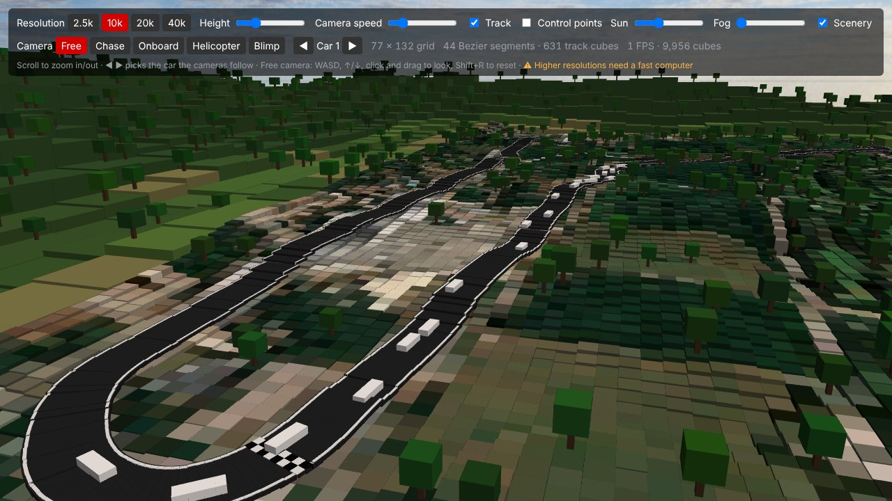 | 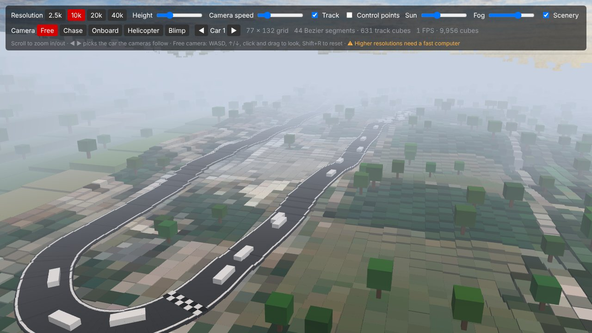 |

| Sun low | Sun at noon |
|---|---|
| 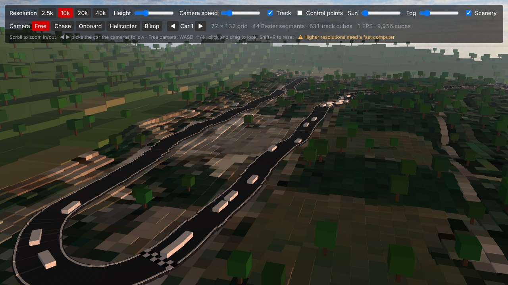 | 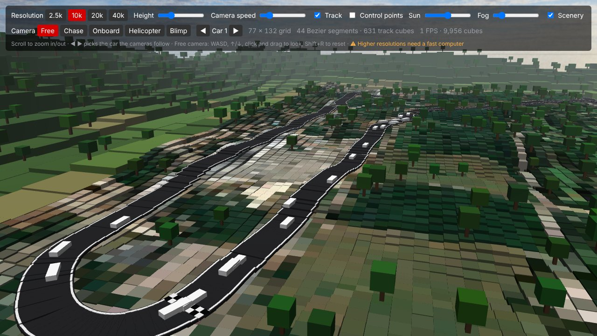 |

| Chase | Onboard |
|---|---|
| 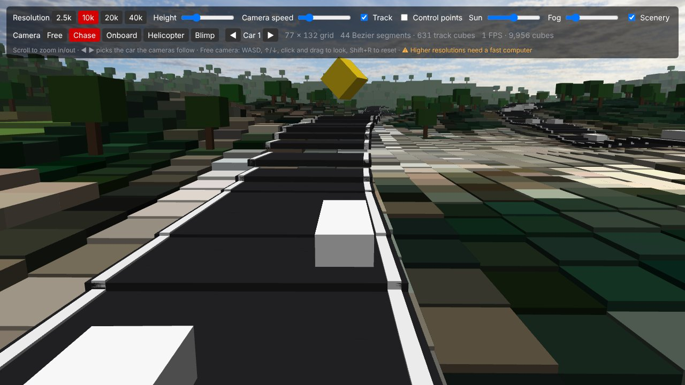 | 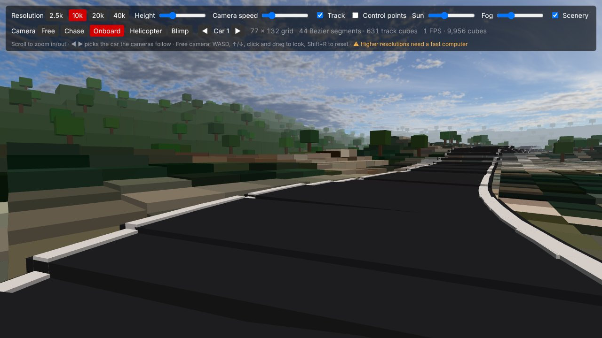 |
| **Helicopter** | **Blimp** |
| 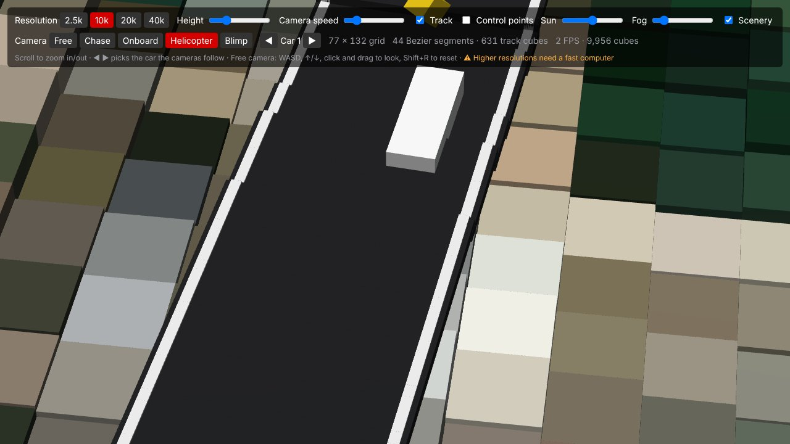 | 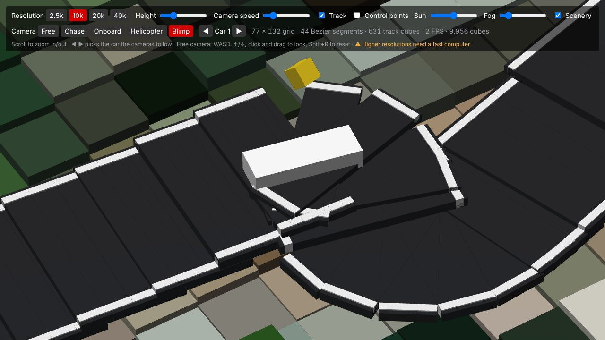 |

Level 4 builds up on Level 3 with a sun, fog, skybox, scenery around the map and different cameras.

| Control | What it does |
|---|---|
| Sun slider | Change the sun and the time of the day |
| Fog slider | How thick the fog is |
| **Scenery** checkbox | Hills, fields and trees around the map |
| **Free / Chase / Onboard / Helicopter / Blimp** | Camera |
| **◀ ▶** | Which car the car cameras follow |
| Mouse wheel | Zoom |

**Skybox.**  <!-- To do Cameron: Add ur explanation-- >

**Fog:** The vertex shader calculates how far each vertex is from the camera. After `uView` the camera sits at (0, 0, 0), so the distance is just the length of the point:

```glsl
vec4 cameraSpace = uView * uModel * vec4(aPosition, 1.0);
vDistance = length(cameraSpace.xyz);
```

Then the fragment shader mixes the pixel's color toward the fog color the farther away it is. We went with exponential squared fog which keeps things close to you clear and then fades out pretty quickly:

```glsl
float fogAmount = 1.0 - exp(-pow(uFogDensity * vDistance, 2.0));
gl_FragColor = vec4(mix(color, uFogColor, fogAmount), 1.0);
```

**Sun:** *(AI helped with this part.)* The slider is the sun's angle above the horizon. We turn that into a light direction, and the light gets more orange the lower the sun gets- like a sunset:

```js
const sunAngle = Number(sunSlider.value) * Math.PI / 180;   // degrees → radians
const sunHeight = Math.sin(sunAngle);                        // 0 at the horizon, 1 at noon
gl.uniform3fv(uLightDirection, [Math.cos(sunAngle), sunHeight, 0.3]);
gl.uniform3fv(uLightColor, [1.0, 0.55 + 0.45 * sunHeight, 0.3 + 0.7 * sunHeight]);
```

The shader uses the same `dot` lighting as Level 1, just with the sun's direction and color instead:

```glsl
float brightness = max(dot(normalize(vNormal), normalize(uLightDirection)), 0.0);
vec3 light = vec3(0.3) + 0.7 * brightness * uLightColor;
```

**Cameras:** Every camera is really just the same three things: an eye, a target and a field of view, which all go into `lookAt` and `perspective`. Zooming is just changing the field of view (narrow = zoomed in).

- **Chase**: behind and above the car. It glides towards where it wants to be instead of snapping to it, so it doesn't look shaky:

  ```js
  const want = [pos[X] - dir[X] * L * 2.5, pos[Y] + L * 0.9, pos[Z] - dir[Z] * L * 2.5];
  const k = chaseEye ? 1 - Math.exp(-dt * 6) : 1;
  chaseEye = (chaseEye || want).map((v, i) => v + (want[i] - v) * k);
  ```

- **Onboard**: at the front of the car looking straight ahead- like you're the driver.
- **Heli / Blimp**: the eye sits under the helicopter (whichever one is closest to the car) or under the blimp, and the target is the car. Since they're pretty far away, we pick the field of view that keeps about 3 car lengths on the screen. Something of width `w` at distance `d` fills the view when `tan(fov / 2) = (w / 2) / d`:

  ```js
  const distance = Math.hypot(...subtract(pos, eye));
  const fov = 2 * Math.atan((L * 3 / 2) / distance) * zoom;
  ```

**Procedurally generated scenery:** The satellite image stops at the edge of the map, so we filled the land around it with 6 × 6 tiles. Their heights come from noise:

1. A seeded random number generator (`seededRandom(2026)`) so the scenery is the same every time you load the page.
2. Value noise: every grid point gets a random number, and for any (x, z) we blend the 4 grid points around it.

   ```js
   const sx = fx * fx * (3 - 2 * fx);   // smoothstep
   const top = a + (b - a) * sx;        // blend along x...
   const bottom = c + (d - c) * sx;
   return top + (bottom - top) * sz;    // ...then along z
   ```

3. Fractal noise: we stack 4 layers of value noise, each one twice as detailed and half as strong. That's what gives us big hills with smaller bumps on top of them.

   ```js
   for (let layer = 0; layer < 4; layer++) {
     sum += amplitude * valueNoise(x * frequency, z * frequency);
     frequency *= 2;
     amplitude *= 0.5;
   }
   ```

Tiles right next to the map start at the height of the map's edge and blend out into the hills so there's no cliff. Trees (a trunk cube and a leaves cube) only go on green ground and never on the road. All of this gets worked out once, not every frame.

### Level 4 Fun (bonus)
| Chase | Onboard |
|---|---|
| 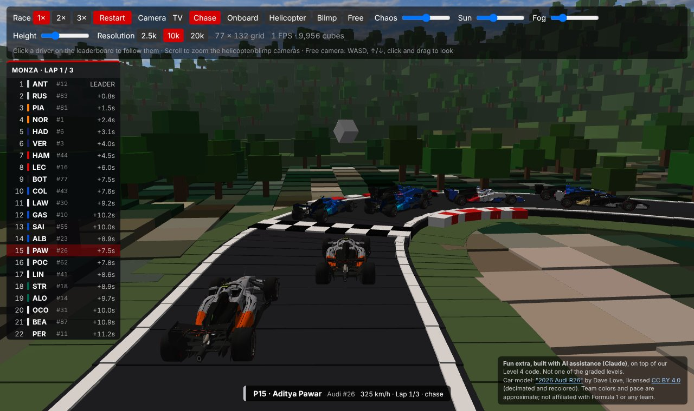 | 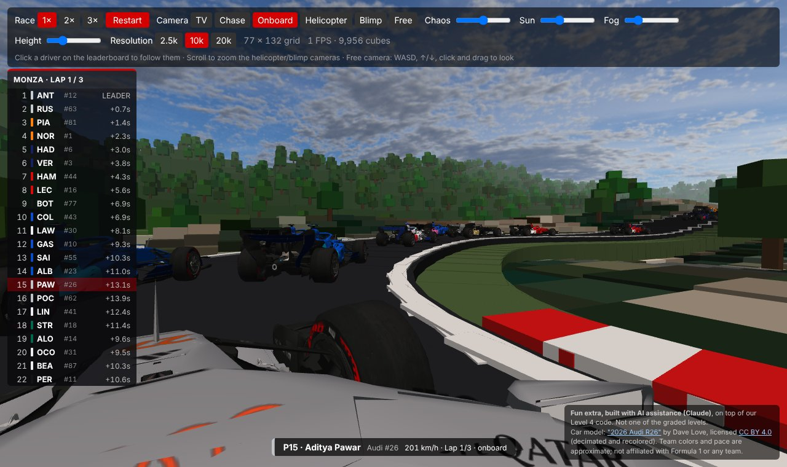 |
| **Helicopter** | **Blimp** |
| 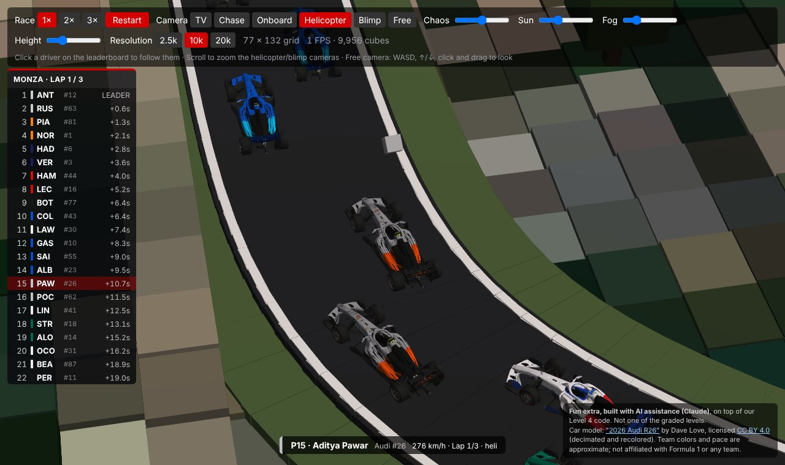 | 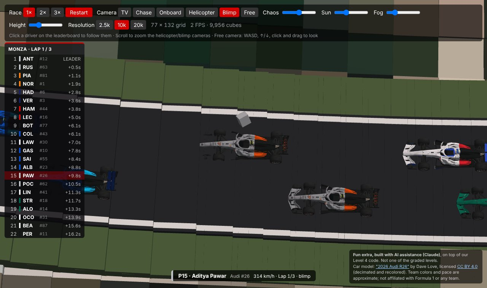 |

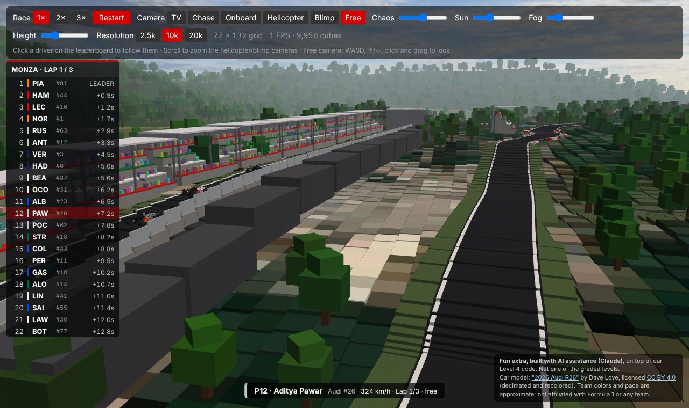

This tab is an extra we built **with AI assistance (Claude)** on top of our Level 4 code and it's labelled that way on the page too. The idea was to make it feel like an F1 Team Manager game where you watch a full race play out, follow any driver you want, and switch between TV-style cameras.

It's a 3-lap race with the 2026 F1 grid- 22 cars using a real 3D model of the **2026 Audi R26** recolored for each team. We put ourselves in as the Audi drivers: **Aditya Pawar #26** and **Cameron Pocisk #62**.

| Control | What it does |
|---|---|
| **Race 1× / 2× / 3×**, **Restart** | Simulation speed, and a new race |
| **TV / Chase / Onboard / Helicopter / Blimp / Free** | Cameras. **TV** cuts between shots and follows the closest battle |
| **Chaos** slider | More randomness: bigger pace swings, more mistakes, more overtakes |
| **Leaderboard** (left) | Live positions and gaps. Click a driver to follow them |
| Sun / Fog / Height / Resolution, mouse wheel | Same as Level 4 |

Compared to Level 4, the cars brake for corners, slipstream each other and get DRS on the straights. The track also has grandstands, a pit wall, garages and kerbs. How we got the car model in is in [Section 6](#6-how-we-made-the-assets).

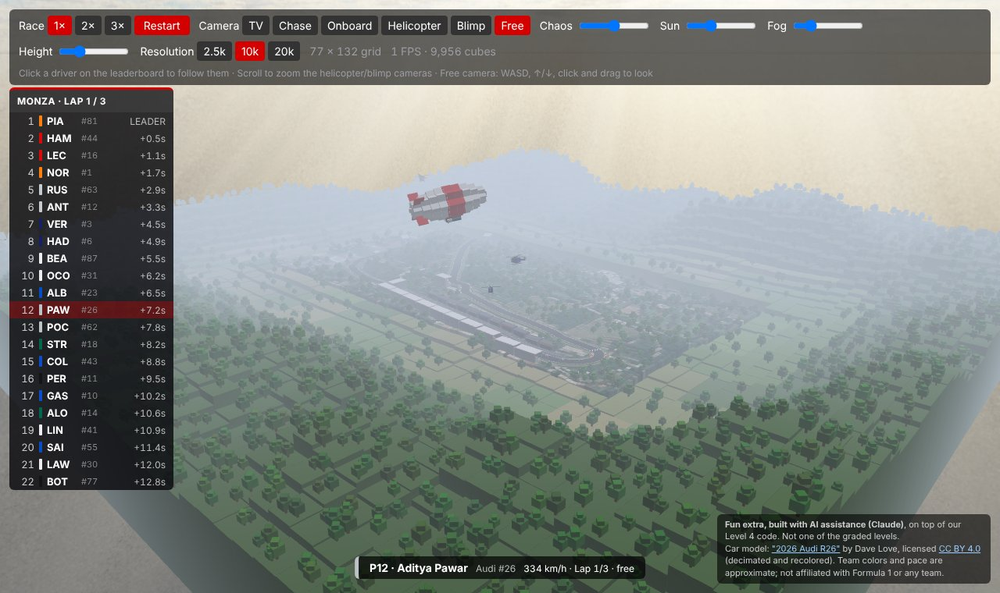


## 4. Bézier curves

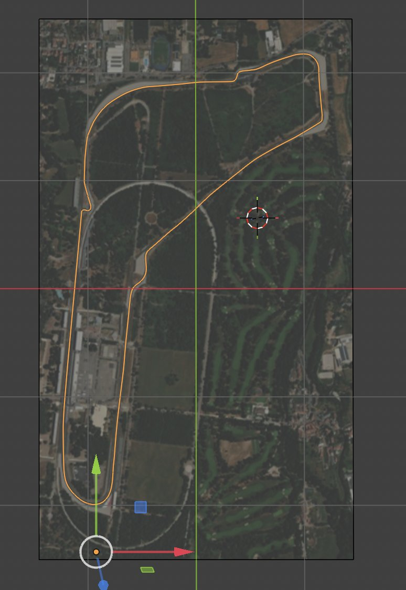

*The track traced in Blender on top of the satellite image. The orange line is the Bézier curve.*

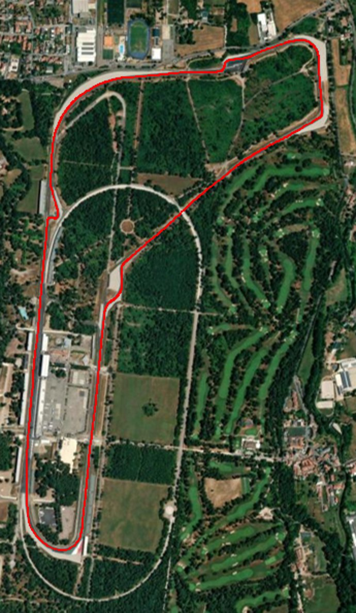

*The same curve in Level 3, with the control points turned on.*

<!--
The brief says: "describe the bezier curve function you selected."
- The formula, and what P0..P3 do
- Your hand calculation of B(0.5) from your notebook
- The derivative, and what you use it for
- The four places you used curves: track, blimp, helicopters, control polygon
- Something you noticed (cars bunching up: t is not distance)
-->


## 5. Future work

<!-- What would you do next? What did you try and not finish? -->


## 6. How we made the assets

### Satellite image and heightmap

<!-- Cameron: check this is right -->
We got the heightmap from [heightmapper](https://tangrams.github.io/heightmapper/#15.33256/45.6171/9.2877) and the satellite imagery from [World Imagery Wayback](https://livingatlas.arcgis.com/wayback/#mapCenter=9.28770%2C45.61710%2C15&mode=explore&active=63116), both zoomed to the same area around Monza. We overlaid the heightmap on the satellite image at half opacity to line them up, then cropped both the same way (`assets/MonzaSataliteJustTrack.png`, `assets/MonzaHeightmapJustTrack.png`).

### Porting the Bézier track from Blender

(The Blender screenshot is in [Section 4](#4-bézier-curves).)

1. **Trace it:** In Blender we added the same satellite image that the landscape uses as a reference image, looked straight down at it (top view), and set it to 5 units tall. Then we traced the circuit with a Bezier Curve- an anchor point at the start, apex and end of each corner with the handles lined up along the track. Turn 1 (the chicane) needed 4 points on its own because of how tight it is. Then we closed the curve into a loop (Option + C) and applied its transforms (Ctrl + A) so the coordinates it stores are the real ones. That left us with 44 anchor points.

2. **Turn anchor points into segments:** Blender stores each anchor point with a left and right handle. A cubic Bezier segment needs 4 points, so between every pair of anchors next to each other (`a` and `b`) we take:

   - P0 = `a`, P1 = `a`'s right handle, P2 = `b`'s left handle, P3 = `b`

   Segment i's P3 is the same point as segment i+1's P0, which is why the track is one connected loop. And since the handles on each anchor are lined up, the direction doesn't jump where two segments meet either.

3. **Export it:** `export_track.py` runs inside Blender's Scripting tab and writes all 44 segments into `track_points.js`. Blender has z pointing up but WebGL has y pointing up, so the script keeps Blender's x and flips Blender's y into our z:

   ```python
   pts4 = (a.co, a.handle_right, b.handle_left, b.co)   # P0, P1, P2, P3
   ...
   return f"[{p.x:.3f}, {-p.y:.3f}]"                     # Blender (x, y) -> our (x, z)
   ```

   `track_points.js` is just a list of numbers (`const TRACK_SEGMENTS = [...]`) that gets loaded with a `<script>` tag before `level3.js`. If we ever change the curve in Blender we just run the script again.

4. **Line it up with the cubes:** The numbers are in Blender units but our landscape is in cubes- and how many cubes there are changes with the resolution buttons. So `blenderToWorld` first turns a Blender point into a fraction across the image (0 = left/top edge, 1 = right/bottom edge) and then turns that fraction into a column and row of the cube grid. Since the reference image in Blender is the same image the landscape was made from, the track lands right on the real track at any resolution:

   ```js
   function blenderToWorld([bx, bz]) {
     const u = bx / BLENDER_IMAGE_WIDTH + 0.5;    // 0 = left edge of the image, 1 = right edge
     const v = bz / BLENDER_IMAGE_HEIGHT + 0.5;   // 0 = top edge, 1 = bottom edge
     return [
       (u * mapCols - (mapCols - 1) / 2) * SPACING,
       (v * mapRows - (mapRows - 1) / 2) * SPACING,
     ];
   }
   ```

5. **Put it on the ground:** The curve from Blender is flat (2D), so the first time we drew it half of it was buried under the landscape. Now every road piece and every car looks up the height of the landscape cubes underneath it (`roadHeightAt`) and sits on top of the highest one.

### Porting the car model (Level 4 Fun only)

| Straight from Sketchfab: 224,246 triangles | After Decimate: 16,818 triangles |
|---|---|
| 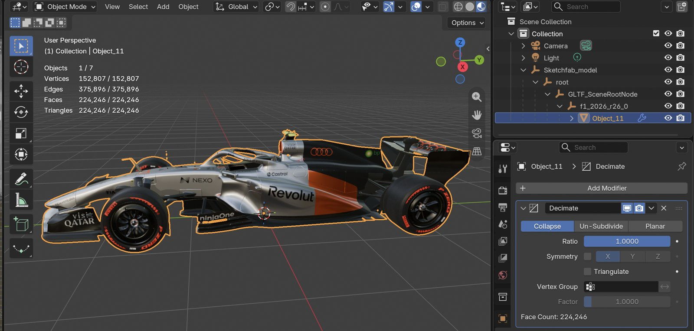 | 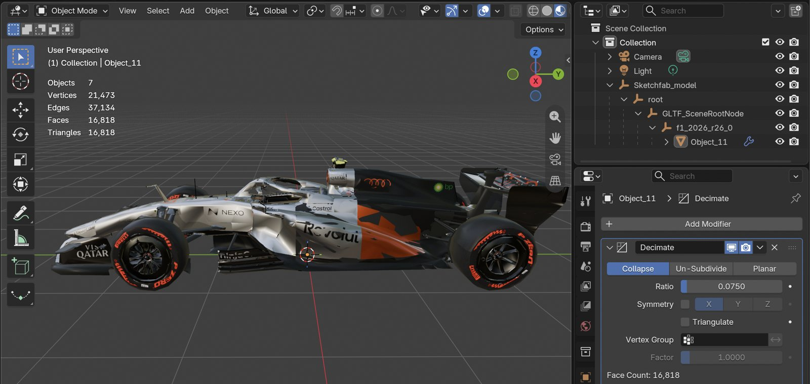 |

1. **Get the model:** We downloaded the "2026 Audi R26" from Sketchfab (CC-BY, credit below) as a `.glb` and imported it into Blender. Prof. Aurisano gave us the okay to use one model that isn't made of cubes.

2. **Make it lighter:** It came in at 224,246 triangles and we wanted 22 of them on the track at once- way too heavy. We used Blender's Decimate modifier (Collapse) at a ratio of 0.075 which brought it down to 16,818 triangles. You can see what it cost us in the second picture: the logos (like "Revolut") get a bit crumpled, but from the race cameras you can't really tell.

3. **Export as OBJ:** We exported it as a Wavefront `.obj` (the shape: positions, normals and texture coordinates) along with a `.mtl` file (the materials and which image each one uses). We went with OBJ because it's plain text, so we could write a loader for it ourselves without any libraries.

4. **Fix the textures:** The images were packed inside the `.glb`, so the exported `.mtl` was pointing at files that didn't exist and the car came out all white. We pulled the 15 images out of the `.glb` into `assets/car/textures/` and pointed each material's `map_Kd` line at the right one.

5. **Load it in WebGL:** `ObjModel.js` is a small loader with no libraries (written with AI like the rest of the Fun level). It reads the `v`, `vt`, `vn` and `f` lines, turns every face into triangles, and puts the whole car into one buffer with 8 numbers per vertex (x, y, z, normal x, y, z, u, v). It also remembers which range of triangles uses which material, so each material gets one draw call with its own texture.

6. **Drive it on the track:** The model gets scaled to 1 unit long and moved so its wheels sit at y = 0. After that it's placed exactly like the white boxes in Level 3: `targetTo(position, position + tangent)` on the Bezier Curve.

7. **Team colors:** The car's paint is one texture made up of colored squares (silver, black, Audi orange), and every painted panel reads its color from one of those squares. For each team we copy that image onto a canvas, paint over the squares with the team's colors, and use that as the car's texture. Audi keeps its real livery of course!


## 7. AI use

<!-- Honestly: what did you use AI for, and what did you do yourselves? -->

**Aditya:**

I used Claude to guide me through the concepts when I got stuck especially when dealing with Bezier Curves. It helped a lot after I drew the track out in Blender and then ported over to our WebGL environment. The path tracing for the objects using the curves was my own but making the objects like Helis, Blimps, and the trees were generated by the AI. 

I believe I was able to use AI to help with my concepts especially when it came to doing the Fog aspect and the Procedurally generated Scenery. 

The explanations it gave were helpful in me making that a reality. Now obviously, Level 4 (fun/bonus) was letting Mr Claude run wild with how crazy it can go with what we already had on Level 4 and I think the end result was fun but choppy. I chose not to work iteratively on that bonus Level just to show how choppy AI can output without a human in the loop. 

**Cameron:**


## 8. Credits

### 3D model
"2026 Audi R26" (https://skfb.ly/pOvCu) by Dave Love SketchFab is licensed under Creative Commons Attribution (http://creativecommons.org/licenses/by/4.0/).


